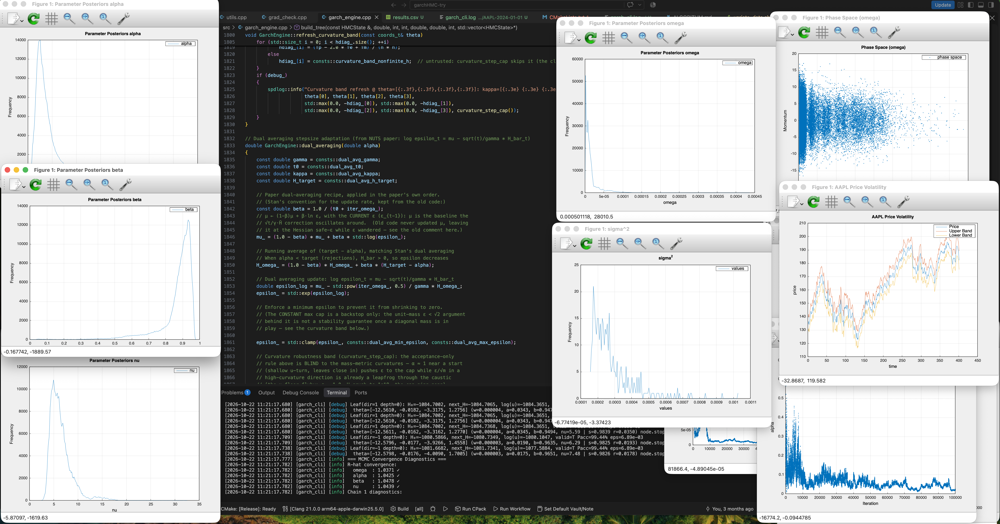
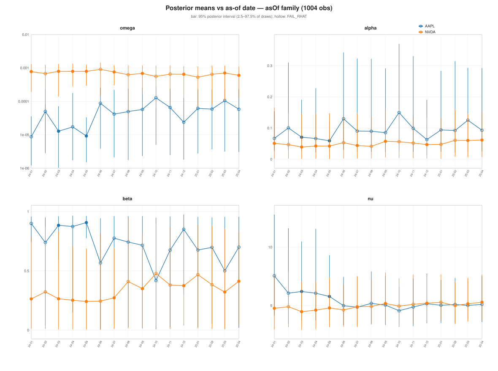
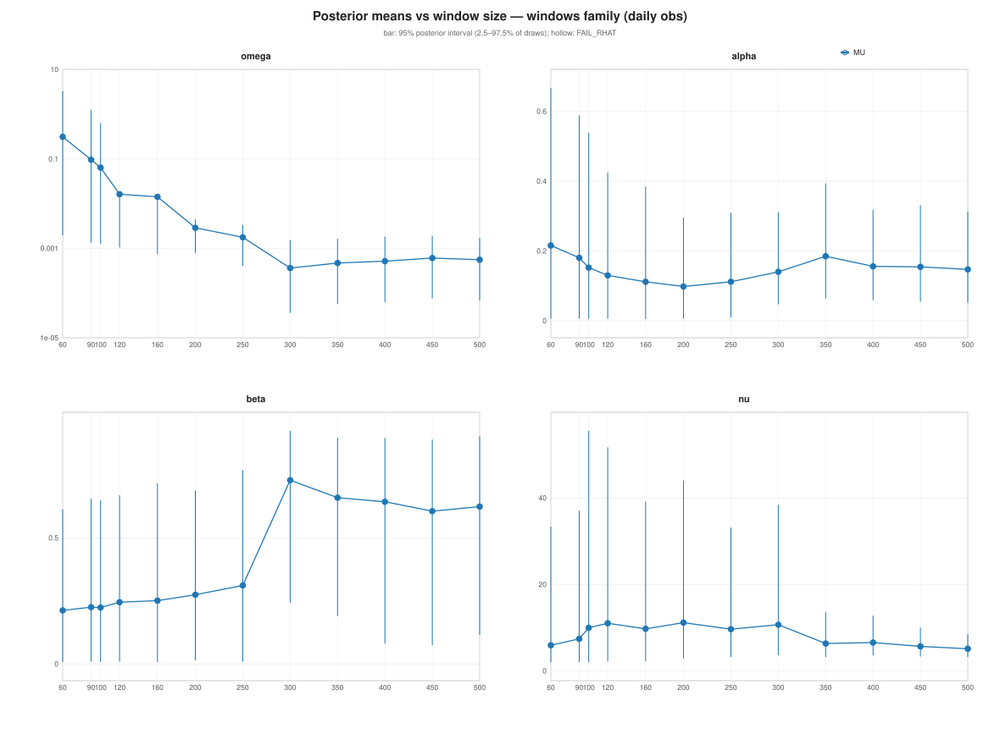
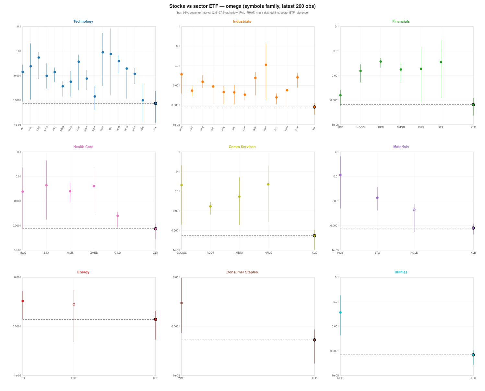
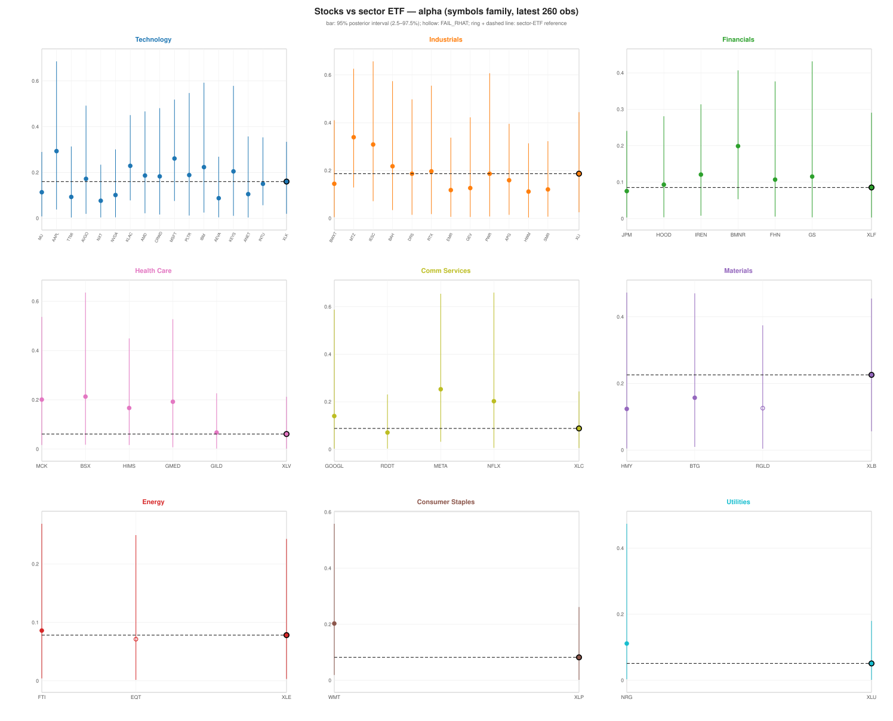
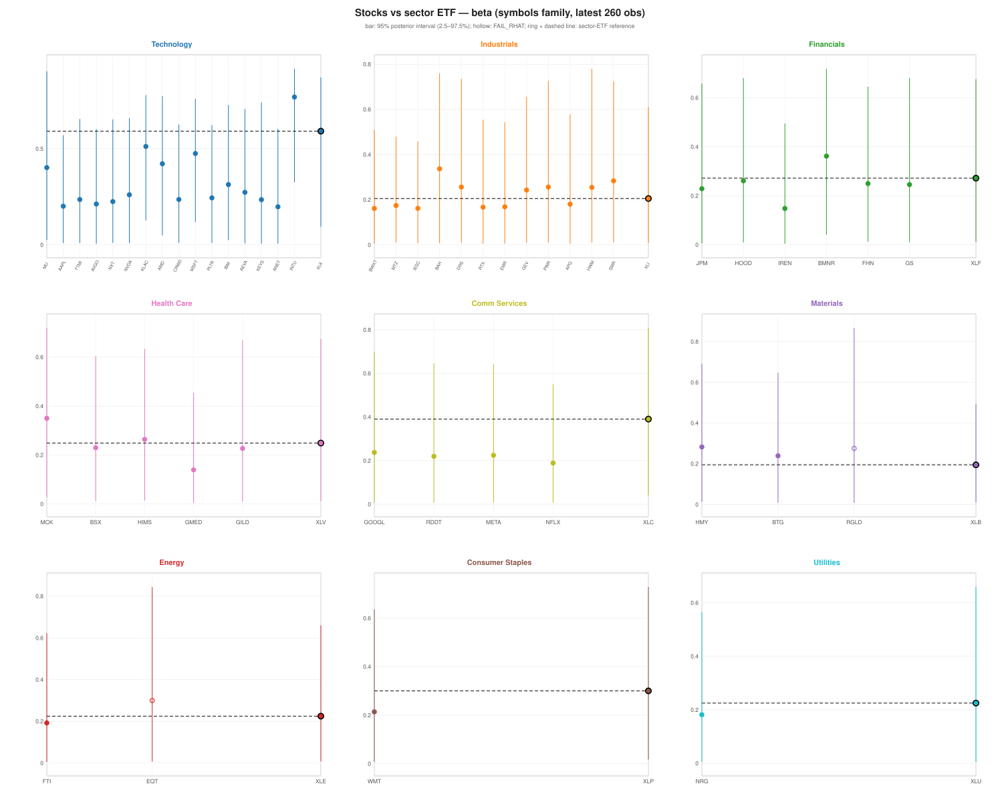
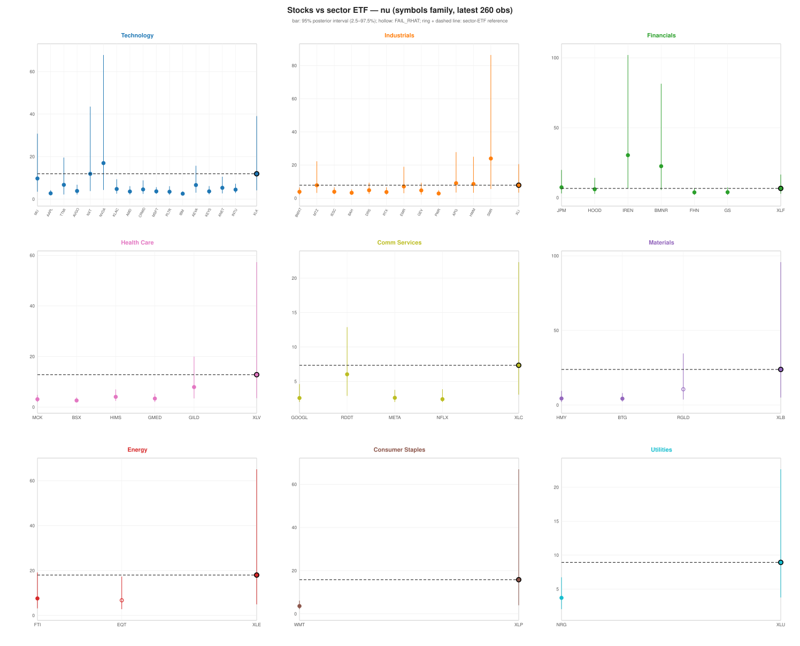

Fitting GARCH(1,1) models via NUTS on a 1,004-day market returns window isn't just about crunching likelihoods—it's navigating a brutal, multi-modal posterior landscape where standard samplers get permanently trapped.

This is the third part of the volatility modeling series—the machinery behind everything here is [part 1](https://lab.embedinker.com/posts/monte-carlo-simulations-volatility-model/) and [part 2](https://lab.embedinker.com/posts/monte-carlo-simulations-volatility-model-nuts/). Here is what it found on long windows.

When modeling extensive return histories, the posterior features a wide, high plateau alongside a lower mode tucked away at the $\omega \to 0$ corner of the persistence ridge, separated by a steep 12-nat drop. A standard MLE seed only finds a local shoulder, and naive samplers explore at best one corner. The lower mode's peak sits $e^{-12} \approx 1.6 \times 10^{-6}$ times the plateau's density—on the full history it contributes a sliver of the posterior mass. But the gap scales with how much data sits on the ridge (the window-size study below varies exactly that), and the two modes carry different $(\omega, \alpha+\beta)$ estimates: what a downstream model reads depends on which basin the chains landed in, and on long histories that must be found deliberately, not left to luck.

To make Bayesian GARCH robust across large datasets, we built a pipeline that tackles these geometric pathologies head-on:

## Custom Coordinate Transformation ($\psi$)

Moving from naive parameters to $\psi = (\ln \omega, \ln s, \text{logit } r, \ln(\nu-2))$—where $s = \alpha+\beta$ captures the ridge direction, $r = \alpha/(\alpha+\beta)$ the mixing ratio, and $\nu$ the degrees of freedom of the fat-tailed likelihood from part 1. This turns the ridge into a natural highway, and the stationarity constraint becomes a smooth repelling wall: $\ln s + \ln(1-s)$ in the prior keeps $s$ off the non-stationary boundary $s=1$ without a hard clip.

## Deterministic Basin Inventory

Instead of guessing where the maximum is, a deterministic scan-ascent-kick search—a coarse grid scan, local ascent from each grid point, then random kicks off each found maximum to expose the shoulders it masks—catalogs *all* local maxima across the landscape. Chains are then explicitly seeded into the distinct basins, instead of wandering into them by luck.

## Curvature-Bounded Step Sizes

Acceptance-only dual averaging tunes $\varepsilon$ against the acceptance rate and is blind to localized curvature—the $\nu$-floor, the $s=1$ wall—which produces H-crushes (trajectories that blow into a wall in a handful of leapfrog steps) and frozen chains. Capping the step against the local curvature ($\varepsilon \le \sqrt{2m_i/\kappa_i}$) and melting that cap away once the chain reaches steady state, so dual averaging resumes control, keeps the leapfrog integrator stable without silent divergences.

The result? Chains seeded in the same basin agree—per-basin $\hat{R} < 1.1$, with reliable ESS over thousands of draws—and the disagreement *between* basins is exactly what the inventory predicted. That is the opposite of the old failure mode, where every chain quietly agreed in the same local well and the diagnostics blessed a single mode.

Building numerical engines from the ground up hands you what no library call does: total control over memory, Hessians, and symplectic flows—and the ability to reshape the landscape before a sampler ever touches it.

## Results

The figures below are somewhat polished, but still preliminary—and we think they're revealing. All runs use the same pipeline and the same dataset—individual names across seven sectors, benchmarked against their sector ETFs—with the long 1,004-day window as the baseline; each subsection varies one axis of the problem, never the model.

### Timeline variation

Posterior means re-estimated month by month, as-of January 2024 through April 2025, with 95% posterior bars; hollow points are fits whose chains failed the $\hat{R}$ check. The means track the volatility regime as the data moves, and the hollows mark where the landscape was hardest for the chains to cross.

### Window size variation

The same fits with the window length varied, from tens to hundreds of days. This is the control experiment the multi-modal story calls for: the 12-nat gap between plateau and corner is a function of how much data sits on the ridge, and the panels show the posterior means as that length—and nothing else—moves.

### Stock Versus Sector

Fits on the individual names of the seven sectors, over each name's most recent 260 days, with the sector ETF as the anchor in every panel. The spread of a name around its sector's parameters is the model's read on that name's idiosyncratic volatility.

## Contact

How do you handle multi-modality in your custom MCMC pipelines? Let's [discuss](mailto:razvan@embedinker.com).
