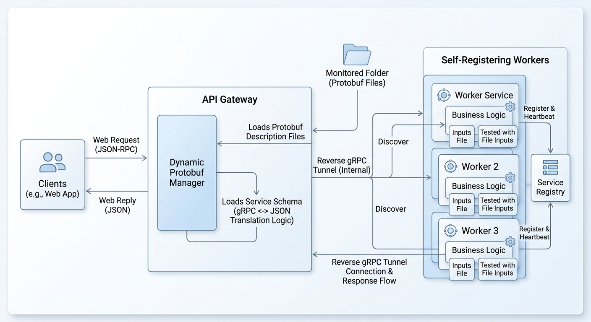

A production microservices stack has a gravity problem. Everything in it pulls at you to add one more system: a service mesh for traffic policy, a discovery cluster for location, a config service for knobs, a flag service for rollouts. Each one justifies itself in isolation—and each one is a deploy target, a failure mode, and a pane of glass you're now on-call for at 3am.

We wanted the capability of that stack—routing, registry, health, runtime extensibility—without taking on the tenants. What we ended up with is smaller than the idea sounds: one stateless API gateway, workers that dial *out*, and Protobuf schemas that are files, not deploys.

Each part of the diagram does one job, and each job is one that a reference stack would own with a separate system. This post walks the six—why each one exists, and what it replaces.

## The Inversion: Workers Dial Out

The keystone decision is a one-line observation about firewalls. Outbound traffic is something you rarely have to ask for; inbound is what's gated, case by case. So instead of exposing a port, claiming an address, and appearing in DNS, a worker does one thing on startup: it dials the API gateway and holds a persistent gRPC tunnel open.

In that moment of dialing, the worker has already registered—connection and registration are the same event, which is what makes "self-registering" a literal description rather than a marketing one.

A request then travels the distance the worker itself chose. A client's JSON-RPC call lands on the gateway, and the gateway rides the worker's own tunnel to reach it—request and reply on the same tube, with the direction of initialization inverted from the conventional diagram.

The consequences cascade. Because the worker initiated the connection, it exposes no port: no ingress rule to write, no address to reserve, no network team to ask. Because the connection points *at* the gateway, the gateway already knows the worker exists—which dissolves an entire class of infrastructure, covered next. And a worker can live behind a NAT, on a laptop, or in a throwaway container; what matters is that it can reach the gateway, not where it sits. From the platform's point of view, a worker running in the fleet and a worker you run locally for a test are the same object wearing different networks.

## The Gateway Is the Registry

In the reference stack, service discovery is a *system*—a cluster whose job is to describe what other systems are doing, complete with its own quorum, its own TTLs, and its own failure modes. Here the registry is not a system. It is the set of open, authenticated tunnels.

The worker table in the gateway is defined by the tunnel table. A worker becomes "discovered" the instant its tunnel opens—and because the tunnel is mutual-TLS (the fabric gets its own section below), the gateway doesn't learn that *something* dialed; it learns exactly *who* dialed. The heartbeat is not a separate protocol riding alongside; it is the liveness of the tunnel itself, checked on the same connection. The worker drops, or its certificate stops verifying, and the gateway prunes the entry. There is no stale record waiting for a TTL to expire, because the thing that describes the worker *is* the connection to the worker.

That's the consequence most worth internalizing: the registry and the reality it describes are the same object. No second system has to be kept in sync with the first, because there is only one.

## Schemas Are Files

The gateway's extension surface is a watched folder. Protocol Buffers description files—the `.desc` artifacts the compiler emits from the `.proto` sources—live in a local directory the gateway monitors. Drop a new descriptor in, and the gateway loads it: it learns the new endpoint's shape, how to validate a JSON-RPC payload against it, and how to translate between the web side's JSON and the tunnel side's canonical protobuf. No gateway restart, and no gateway *deploy*—the gateway's code is service-agnostic; service knowledge is data in a folder.

Versioning rides the same path: a new schema version is a new file. The endpoints clients can call and the endpoints workers are willing to serve are declared by what's in the folder and what's in the tunnel table—and their intersection is the routable surface. One quiet bonus for web clients: they speak plain JSON-RPC to the gateway and never see the protobuf wiring at all.

## mTLS: One Fabric for Every Node

The design principle behind the peer links is slightly broader than the diagram shows. Mutual TLS is the *one* authentication fabric, and it runs across every node in the system—the reverse tunnels included. A worker presenting its leaf certificate on dial is how the worker introduces itself at registration, so the "who dialed" in the registry section is identity, not an IP address.

For the flows that go worker to worker directly, the same fabric applies: peers authenticate one another by the same standard, and there is no second authentication story to keep in step—no tokens to issue, no secrets to hand off, no per-pair configuration to maintain. Identity travels in the transport; everything else about a peer becomes a business decision instead of an infrastructure one.

## File-Driven Worker Testing

Because business logic lives cleanly inside the worker, as a function of validated input, *testing* a worker needs nothing that talks. You feed test inputs from files straight into the handler—no mock gateway, no network layer, no containerized environment. The seam between transport and logic is the handler's signature: file in, message out—so the test is a directory of files.

Those same files do double duty as golden vectors, and as the examples the next developer reads when they pick up a handler. A worker is testable to the degree its logic was *drawn* as a function of its input—and that's the same discipline that made the file-driven schemas possible. The tests and the schemas are one habit, applied to two seams.

## Stateless Scale, Canaries as Deploys

A request-reply worker with no local state makes the boring operations boring. Scaling is a number. A canary is the same: bring up a fraction of the new version of a worker alongside the running fleet, point a share of the traffic at it, watch, and either grow the share or scale it to zero. The rollout *is* the deploy—and the registry table is the traffic-split configuration, since the workers tell the gateway which version they are when they register. There's no flag service to consult and no mesh plane to reconfigure.

## What We Gave Up

No honest write-up without the costs, and there are four:

1. **The gateway is the one stateful-ish box in the picture.** It holds the tunnel table. The mitigation is the *direction* of the dial: if the gateway restarts, workers notice their tunnel drop and redial, and the registry rebuilds itself from the workers' side of the connection. What's lost in the blip is in-flight requests, not topology. We traded a discovery *cluster* for one *box*—and a health check on that box.
2. **The path has an extra hop.** Client to gateway to worker, rather than client straight to worker. For an internal platform, the few milliseconds of tail are cheaper than the discovery system they displace.
3. **The watched folder must be written to atomically.** Stage the file, then rename it—or one of the descriptor loads can read a half-written `.desc` from an editor that saves in place.
4. **mTLS has a rotation cadence, and it's ours.** Leaf certificates do expire, and their renewal is now a job on our own calendar.

The pattern across the four: they are all *file* and *protocol* problems—things a careful developer can see and fix in an editor. The bloat we removed was *system* problems: quorums, drift, and dashboards. That asymmetry is the entire trade, stated flat.

## The Part Count

Since 3am is really a question about deploy targets, let's count them. The reference stack this replaces is a service mesh—data plane and control plane—plus a discovery cluster, a config service, and a flag service: five systems, each with its own dashboards, its own upgrade path, and its ideas about an outage.

The stack here is three: the gateway, the workers, and a certificate authority for the peer links. Two of the three are stateless.

I'm not going to attach a benchmark to that number—this is a maintenance-surface win, not a throughput one, and it has no nanoseconds to print. The win is the *count* of "which system is on fire?" questions you ever have to answer: no cluster to quorum, no sidecar to crash-loop, no discovery to drift, one folder to watch.

## Contact

How do you keep a small internal platform from eating its own maintenance? Let's [discuss](mailto:razvan@embedinker.com).
